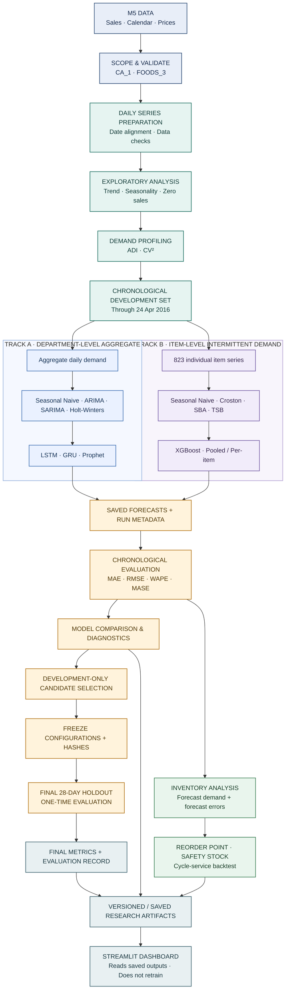
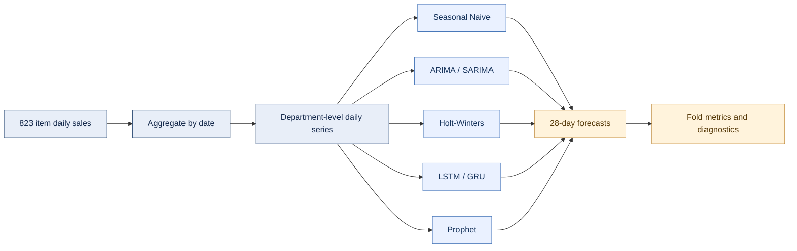
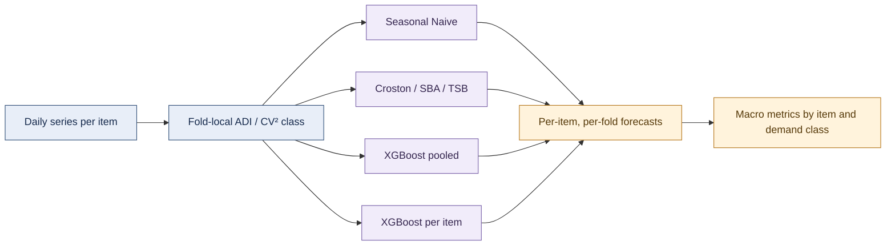
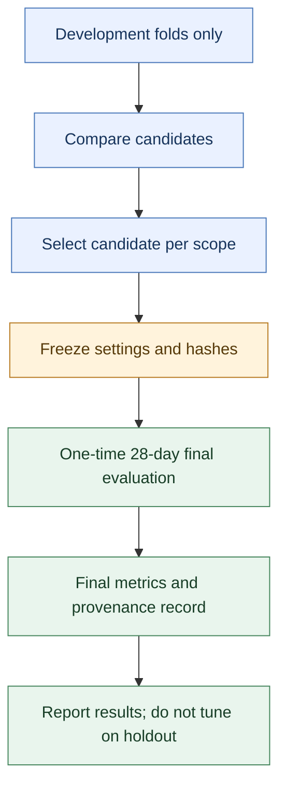
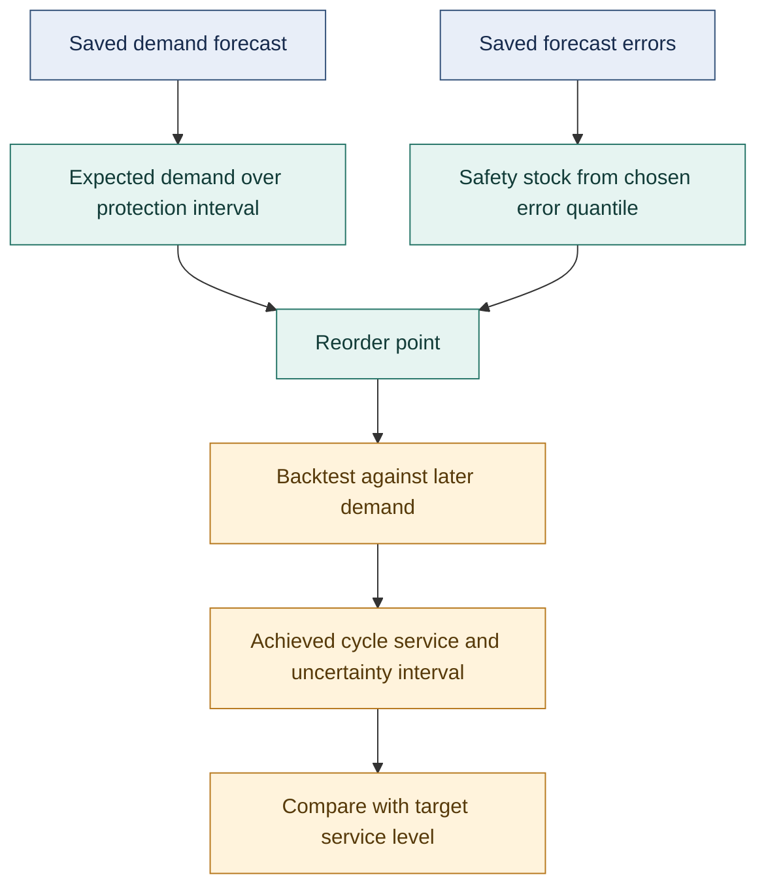

<div align="center">

# RiverDemand

### Intermittent Retail Demand Forecasting & Inventory Decision Support

**A comparative forecasting study across statistical, machine-learning and deep-learning methods.**

[](https://www.python.org/)
[](https://streamlit.io/)
[](https://intermittent-retail-demand-forecasting-h4ep7gtxns9mfye7fcgpnt.streamlit.app/)
[](https://github.com/nitishhkr11/intermittent-retail-demand-forecasting)
[](https://pytorch.org/)
[](LICENSE)

**823 items** &nbsp; · &nbsp; **1,941 days** &nbsp; · &nbsp; **11 forecasting approaches** &nbsp; · &nbsp; **6 dashboard pages**

</div>

---

**Forecasting intermittent retail demand with statistical, machine-learning and deep-learning models**

RiverDemand is an end-to-end forecasting and inventory decision-support project built around a difficult retail problem: many products sell irregularly, with long gaps between sales and occasional spikes in demand. A single forecasting method is unlikely to work equally well across every item, so the project compares models at both department and item level, evaluates them with chronological backtests, and presents the saved results in a Streamlit dashboard.

The study uses the **Walmart M5 Forecasting – Accuracy** data for store `CA_1`, department `FOODS_3`: **823 items across 1,941 daily observations**, from **29 January 2011 to 22 May 2016**.

> **Project status — 16 November 2026:** The research phases, expanded development experiments, dashboard QA and one-time final-holdout evaluation are complete. The protected 28-day holdout was evaluated once after candidate freeze. The dashboard is deployed on Streamlit Community Cloud: [open the live RiverDemand app](https://intermittent-retail-demand-forecasting-h4ep7gtxns9mfye7fcgpnt.streamlit.app/). The hosted application reads saved artifacts and does not train models or access the protected final holdout.

---

## At a glance

| Area | Project scope |
|---|---|
| Business problem | Forecasting intermittent product demand and translating forecast errors into inventory signals |
| Dataset | Walmart M5 Forecasting – Accuracy |
| Data slice | Store `CA_1`, department `FOODS_3` |
| Products | 823 items |
| Observation period | 29 Jan 2011 – 22 May 2016 (1,941 days) |
| Development cutoff | 24 Apr 2016 |
| Final evaluation window | 25 Apr 2016 – 22 May 2016 (28 days) |
| Forecasting approaches | Seasonal Naive, ARIMA, SARIMA, Holt-Winters, Croston, SBA, TSB, XGBoost, LSTM, GRU and Prophet |
| Evaluation | Expanding-window and disjoint chronological backtests; a separately controlled final holdout |
| Decision-support layer | Reorder point, safety stock and cycle-service backtesting |
| Application | Six-page Streamlit dashboard with light and dark themes |
| Public application | [RiverDemand on Streamlit Community Cloud](https://intermittent-retail-demand-forecasting-h4ep7gtxns9mfye7fcgpnt.streamlit.app/) |

## Contents

- [Why this problem matters](#why-this-problem-matters)
- [What the project does](#what-the-project-does)
- [Workflow and evaluation protocol](#workflow)
- [Models compared](#models-compared)
- [Results](#results)
- [Inventory decision-support layer](#inventory-decision-support-layer)
- [Streamlit dashboard](#streamlit-dashboard)
- [Live application](#live-application)
- [Getting started](#getting-started)
- [Repository layout](#repository-layout)
- [Reproducibility and project records](#reproducibility-and-project-records)
- [Limitations](#limitations)
- [License](#license)

## Why this problem matters

Retail sales are not always a smooth time series. Some items sell almost every day; others sell intermittently, with zero-demand days followed by non-zero sales. This creates two related challenges:

1. **Forecasting challenge:** models must handle seasonality, changing demand levels, zero-demand periods and occasional spikes.
2. **Inventory challenge:** a forecast is useful only when its uncertainty and errors are understood well enough to inform replenishment decisions.

RiverDemand separates the department-level aggregate series from individual item series. Their volumes and error scales are different, so their metrics are reported separately rather than combined into one model ranking.

## What the project does

- Loads and validates the selected M5 data slice, then performs exploratory analysis.
- Classifies item demand using **Average Demand Interval (ADI)** and **squared coefficient of variation (CV²)**. These describe how frequently demand occurs and how variable non-zero demand sizes are.
- Evaluates statistical, intermittent-demand, tree-based and neural forecasting methods.
- Uses chronological backtesting rather than random train/test splitting.
- Compares aggregate and item-level forecasts using saved, traceable forecast artifacts.
- Converts forecast and error information into reorder-point and safety-stock calculations, then checks achieved cycle service against illustrative targets.
- Serves the saved results through a dashboard. The dashboard does not train models or silently generate replacement forecasts when an artifact is missing.

## Workflow and system architecture

RiverDemand is organised as a sequence of research and application stages. The important design choice is that **model development, model evaluation, inventory analysis and dashboard presentation are separate concerns**. This keeps the forecasting experiments auditable and prevents the dashboard from silently retraining models or changing reported results.

### End-to-end workflow

The diagram below shows the complete path from the M5 source files to the decision-support dashboard. The two forecasting tracks are deliberately separated because a department-level aggregate series and an individual product series have different demand characteristics and error scales.

The diagram uses a restrained palette: **blue** for source data, **teal** for preparation, **blue-violet** for the aggregate track, **violet** for item-level modelling, **amber** for evaluation and candidate control, and **green** for inventory outputs. GitHub renders these Mermaid diagrams as visual charts; the code block is the diagram source, not a screenshot.



### What happens at each stage

| Stage | What happens | Main output / why it matters |
|---|---|---|
| 1. Source data | Read the M5 sales, calendar and sell-price files. Select store `CA_1` and department `FOODS_3`. | A bounded, reproducible study instead of attempting to model the full M5 catalogue. |
| 2. Preparation | Validate the selected data and prepare the daily series and associated calendar information used by the experiments. | Consistent date-indexed inputs for EDA, aggregate models and item-level models. |
| 3. Exploratory analysis | Inspect the aggregate demand pattern, weekly behaviour, item-level sales and zero-demand periods. | Establishes what the time series look like before selecting forecasting methods. |
| 4. Demand classification | Calculate ADI and CV² for item demand and group items into smooth, intermittent, erratic and lumpy patterns. | A demand-pattern view for interpreting model performance; the classification is not treated as a universal model winner. |
| 5. Development evaluation | Use chronological training prefixes and later forecast windows. Fit fold-dependent transformations and settings using the training data available at that origin. | Forecasts from comparable time windows without random time-series splitting. |
| 6. Forecasting | Run separate model families for the aggregate series and individual products. | Saved forecasts, model metadata and failure records. |
| 7. Comparison and diagnostics | Recompute metrics from saved forecasts, check date/actual alignment and examine residual behaviour. | A traceable comparison; missing or failed runs are not silently replaced. |
| 8. Candidate freeze | Select candidates using development evidence and record the selected settings and hashes. | A fixed definition of what will be evaluated on the protected final window. |
| 9. Final holdout | Evaluate the frozen candidates on 25 April–22 May 2016 once. | Final, separately reported holdout metrics and an evaluation record. This window is not a tuning set. |
| 10. Inventory analysis | Combine forecast demand over a protection interval with safety stock derived from forecast errors; backtest achieved cycle service. | Reorder-point and safety-stock decision support, with the achieved service level reported honestly. |
| 11. Dashboard | Read the saved model, comparison, reliability and inventory artifacts. | An interactive way to inspect results without training models inside the application. |

### Two forecasting tracks — why the project separates them

**Track A: department-level aggregate demand**

The selected products are aggregated into a denser daily series. This is the setting used for the classical time-series models and for the LSTM, GRU and Prophet experiments.



**Track B: individual product demand**

Individual products can contain long zero-demand runs and irregular non-zero sales. This is where intermittent-demand methods and item-level XGBoost experiments are used. The broader intermittent study covers all 823 products; the five-fold comparison table shown later in this README uses the selected 20-item panel.



The two tracks are reported separately. An aggregate MAE measured in hundreds of units per day cannot be ranked against an item-level MAE measured in units per item per day.

### Chronological evaluation and the protected holdout

The main development benchmark uses five expanding-window folds with 28-day forecast horizons. Each fold trains on all available observations before its forecast origin and evaluates only the next 28 days.

| Fold | Training data ends | 28-day forecast window |
|---:|---|---|
| 1 | 6 Dec 2015 | 7 Dec 2015 – 3 Jan 2016 |
| 2 | 3 Jan 2016 | 4 Jan – 31 Jan 2016 |
| 3 | 31 Jan 2016 | 1 Feb – 28 Feb 2016 |
| 4 | 28 Feb 2016 | 29 Feb – 27 Mar 2016 |
| 5 | 27 Mar 2016 | 28 Mar – 24 Apr 2016 |

Separate expanded studies use 16 disjoint quarterly 28-day windows for selected aggregate models and a 16-fold intermittent-demand experiment across all 823 items. Those results are labelled separately rather than blended into the five-fold benchmark.

The protected final window is **25 April–22 May 2016**. The candidate configurations were frozen using development evidence before the final evaluation. The holdout was then evaluated once; it must not be reused for tuning or model selection. The repository retains the freeze/evaluation records and result hashes under `artifacts/final/`.



### Inventory decision workflow

Forecast accuracy is not itself an inventory policy. The inventory layer takes the forecast and its historical errors and translates them into an illustrative replenishment signal.



The reorder point combines expected demand over the protection interval with safety stock. The analysis uses illustrative lead-time and review-period assumptions and reports achieved cycle service against the target. The experiments did not meet the 95% target consistently; the README therefore makes no claim of a guaranteed 95% service level, reduced stockouts or financial savings.

### Dashboard user journey

The dashboard is the presentation layer for saved results, not another training pipeline. A typical investigation is:

1. Start at **Overview** to understand the selected data and the experiment scope.
2. Use **Forecast Explorer** to inspect an available saved forecast against actual sales.
3. Open **Model Comparison** to compare the eligible models within the same scope.
4. Use **Model Reliability** to inspect uncertainty, residual and provenance information.
5. Open **Inventory Decisions** to examine the reorder-point, safety-stock and service-level analysis.
6. Use **About & Methodology** to check the modelling protocol and limitations.

The dashboard does not fit models or generate replacement predictions. If a required artifact is missing, it identifies the missing file and the command needed to create it.

## Models compared

The project evaluates models at the level for which they are intended to operate.

| Model family | Methods | Evaluation scope |
|---|---|---|
| Baseline | Seasonal Naive | Aggregate and item level |
| Classical time series | ARIMA, SARIMA, Holt-Winters | Department-level aggregate series |
| Intermittent-demand | Croston, Syntetos–Boylan Approximation (SBA), Teunter–Syntetos–Babai (TSB) | Item level |
| Gradient boosting | XGBoost, including pooled and per-item variants | Item level |
| Recurrent neural networks | LSTM and GRU, with univariate and calendar-input variants | Department-level aggregate series and expanded seasonal experiments |
| Additive forecasting | Prophet, including additive, multiplicative and no-regressor variants | Department-level aggregate series |

For XGBoost, the experiments include pooled and per-item approaches, leak-safe features and recursive 28-day forecasts. The expanded work includes full-panel experiments across 823 products and a fixed 183-product sample for per-item modelling. The LSTM/GRU experiments are CPU-based and resumable; Prophet variants are evaluated as separate configurations.

## Results

The results below come from saved experiment artifacts and the final evaluation record. They answer different questions, so the development tables and final holdout results should not be read as one combined ranking.


#### Metrics used

| Metric | What it measures | Interpretation |
|---|---|---|
| MAE | Mean absolute error | Average absolute forecast error in the units of the series. |
| RMSE | Root mean squared error | Penalises larger errors more strongly than MAE. |
| WAPE | Sum of absolute errors divided by total actual demand | A scale-normalised aggregate error measure; it is dimensionless. |
| MASE | MAE divided by the lag-7 seasonal-naive training error | Compares error with a seasonal-naive reference; values below 1 indicate improvement over that reference. |
| MAPE | Mean absolute percentage error | Zero-actual days are excluded and counted; it is not informative for all-zero windows. |

For item-level intermittent demand, percentage metrics require particular care because many actual values are zero or small. The comparison therefore reports multiple metrics and preserves item-level macro-averaging rather than pooling all item-day errors into one number.

### Five-fold development benchmark

The five-fold benchmark is a historical comparison over overlapping training histories. Values are means across the five folds; `MAE std` is the standard deviation of fold MAE. The observed fold-to-fold variation is material, and no statistical significance test was performed.

**Department-level aggregate series** — errors are in units per day.

| Model | MAE | MAE std | RMSE | WAPE | MASE |
|---|---:|---:|---:|---:|---:|
| LSTM (calendar inputs) | 181.6 | 42.9 | 234.7 | 0.094 | 0.690 |
| Holt-Winters (additive trend) | 193.3 | 62.2 | 266.4 | 0.100 | 0.734 |
| GRU (calendar inputs) | 199.3 | 61.0 | 251.8 | 0.103 | 0.757 |
| GRU (univariate) | 203.1 | 73.8 | 278.8 | 0.106 | 0.771 |
| LSTM (univariate) | 209.7 | 81.1 | 286.2 | 0.109 | 0.796 |
| Prophet (additive) | 222.2 | 44.7 | 272.7 | 0.113 | 0.844 |
| Prophet (additive, no regressors) | 225.9 | 53.7 | 294.6 | 0.116 | 0.858 |
| SARIMA(6,1,1) × (0,0,2,7) | 228.0 | 68.8 | 302.2 | 0.118 | 0.865 |
| Prophet (multiplicative) | 228.0 | 46.1 | 279.0 | 0.116 | 0.866 |
| ARIMA(6,1,1) | 245.6 | 44.7 | 333.4 | 0.124 | 0.933 |
| Seasonal Naive | 256.6 | 52.4 | 329.1 | 0.131 | 0.974 |

**Item-level benchmark** — macro averages over 20 selected items; each item contributes equally. Errors are in units per item per day.

| Model | MAE | RMSE | MASE |
|---|---:|---:|---:|
| TSB (α = 0.1, β = 0.1) | 1.954 | 2.500 | 1.410 |
| XGBoost (pooled, no event features) | 1.965 | 2.461 | 1.408 |
| XGBoost (pooled, Poisson loss) | 1.976 | 2.461 | 1.402 |
| XGBoost (pooled) | 1.980 | 2.467 | 1.396 |
| XGBoost (per item) | 2.058 | 2.586 | 1.574 |
| Seasonal Naive | 2.342 | 3.083 | 1.607 |
| Croston (α = 0.1) | 2.380 | 2.876 | 1.553 |

The differences between TSB and the pooled XGBoost variants are small relative to fold-to-fold variation. The best-performing approach also changes across demand classes and metrics; the per-class comparisons are available in notebook 09.

### Expanded development experiments

These experiments broaden the evidence beyond the five-fold benchmark.

| Experiment | Scope | Main development result |
|---|---|---|
| Seasonal models | 16 disjoint quarterly 28-day windows from 2012–2015 | Mean aggregate MAE: SARIMA 254.1; fold-local Holt-Winters 260.7; fold-local ARIMA 319.3; Seasonal Naive 352.9 |
| Intermittent-demand models | 823 items across 16 folds | Successful-cell mean MAE: Seasonal Naive 1.989; Croston 2.290; SBA 2.255; TSB 1.712 |
| LSTM / GRU | Expanded seasonal study | 64 of 64 planned variant-fold cells completed |
| Prophet | Expanded seasonal study | 16-fold coverage completed across the evaluated variants |
| XGBoost | Full 823-item panel, plus a fixed 183-item per-item sample | Expanded pooled and per-item ablations completed |
| Inventory calibration | Earlier-fold calibration evaluated over 930,248 later-fold seven-day windows | The 95% cycle-service target remained unmet; calibration variants achieved 86.72%–92.59% |

Croston and SBA each retain 2,236 failed fits on all-zero training prefixes in the expanded intermittent study. Those failures were not replaced with artificial scores. In the 7-day inventory backtest, achieved cycle service ranged from 91.17% to 93.86% against a 95% target. A separate calibration comparison found 92.47% for all-history empirical calibration and 92.59% for same-class normalization; their 90% cluster-bootstrap intervals overlap, so the simpler all-history rule remains the default.

### Final 28-day holdout — evaluated once

The protected period is **25 April to 22 May 2016**. The final candidates were frozen before this evaluation. These results are reported independently for the aggregate series and the item-level strategy.

| Evaluation scope | Selected approach | MAE | RMSE | WAPE | MASE |
|---|---|---:|---:|---:|---:|
| Department-level aggregate | LSTM (calendar inputs) | 128.087 units/day | 183.143 units/day | 0.0543 | 0.492 |
| Item level, 823 items | Class-selected strategy, macro average | 1.684 units/item/day | 2.188 units/item/day | 1.007 | 1.375 |

Item-level MAPE excludes 8,432 zero-actual rows. Aggregate and item-level metrics have different scales and must not be compared directly. The final holdout is not a tuning set and should not be evaluated again. Full tables, provenance and caveats are in [`FINAL_HOLDOUT_RESULTS.md`](reports/final/FINAL_HOLDOUT_RESULTS.md).

### What the results do — and do not — show

- LSTM with calendar inputs had the lowest mean MAE in the five-fold aggregate benchmark and was the selected aggregate candidate for the final holdout.
- TSB performed well in the selected-item development benchmark and in the expanded intermittent study, but item-level rankings vary by demand class and metric.
- The inventory experiments did **not** reach the 95% cycle-service target. The project therefore does not claim a 95% service level, cost reduction or measured business savings.
- The five-fold benchmark is small and has substantial fold-to-fold variation. No model is claimed to be statistically significantly better than another.

## Inventory decision-support layer

The inventory module translates forecasts and forecast errors into illustrative replenishment signals, including reorder points and safety stock. It then backtests achieved cycle service over later periods against target service levels.

The calculations use illustrative lead-time and service-level assumptions. There is no cost model, no measured stockout-cost reduction and no savings claim. The 95% cycle-service target was not achieved in the reported backtests; the results should be treated as decision-support analysis, not as an operational service guarantee.

## Streamlit dashboard

Run the dashboard locally with:

```powershell
streamlit run app/app.py
```

It contains six pages:

1. **Overview** — project scope, data summary and evaluation status.
2. **Forecast Explorer** — saved forecasts and actuals for the selected scope.
3. **Model Comparison** — model metrics, with aggregate and item-level results kept separate.
4. **Inventory Decisions** — reorder-point, safety-stock and service-level analysis.
5. **Model Reliability** — forecast reliability and diagnostic views.
6. **About & Methodology** — data, modelling and evaluation details.

The dashboard reads saved artifacts; it does not train models. It does not forecast beyond the development cutoff of 24 April 2016. If an expected artifact is missing, the app identifies the file and the command used to generate it rather than substituting another model's output. Each page also provides provenance details for the artifacts it uses. A dark theme is available from the sidebar and can also be opened directly at `http://localhost:8501/?theme=dark`.

## Live application

**[Launch the RiverDemand dashboard](https://intermittent-retail-demand-forecasting-h4ep7gtxns9mfye7fcgpnt.streamlit.app/)**

The public application is hosted on **Streamlit Community Cloud** and is connected to the `main` branch of this GitHub repository. The deployment serves the saved development artifacts packaged with the repository; it does not run the model-training notebooks or retrain forecasting models when a visitor opens the app.

The hosted dashboard provides the same six pages described above: Overview, Forecast Explorer, Model Comparison, Inventory Decisions, Model Reliability, and About & Methodology. It presents the development-period forecasts and diagnostics while keeping the protected final-holdout results separate from dashboard use.

For source code, experiment records and project documentation, visit the [GitHub repository](https://github.com/nitishhkr11/intermittent-retail-demand-forecasting).

## Getting started

### 1. Create an environment

The commands below use Windows PowerShell. From the repository root:

```powershell
python -m venv .venv
.\.venv\Scripts\Activate.ps1
python -m pip install --upgrade pip
python -m pip install -r requirements-phase3.txt
```

`requirements-phase3.txt` installs the project dependencies for the full workflow, including the dashboard and the optional neural and Prophet components. For Phases 1–2 and XGBoost, `requirements.txt` is sufficient. PyTorch is used for LSTM/GRU, Prophet is used for Prophet experiments, and Streamlit/Plotly are used by the dashboard. If an optional model dependency is unavailable, the corresponding model reports the missing package; it is not silently replaced by a different model.

### 2. Add the raw M5 files

The raw dataset is not committed to this repository. Place these files in `data/raw/`:

```text
data/raw/
├── sales_train_evaluation.csv
├── calendar.csv
└── sell_prices.csv
```

Keep the raw data out of Git. The project uses the `CA_1` / `FOODS_3` slice described above.

### 3. Prepare the data

```powershell
python -m src.data.preprocessor
python -m src.analysis.demand_classification
```

### 4. Run the development notebooks in order

Each notebook writes its own experiment artifacts. Execute them in sequence:

```powershell
python -m jupyter nbconvert --to notebook --execute --inplace notebooks/04_classical_models.ipynb
python -m jupyter nbconvert --to notebook --execute --inplace notebooks/05_intermittent_models.ipynb
python -m jupyter nbconvert --to notebook --execute --inplace notebooks/06_xgboost.ipynb
python -m jupyter nbconvert --to notebook --execute --inplace notebooks/07_lstm_gru.ipynb
python -m jupyter nbconvert --to notebook --execute --inplace notebooks/08_prophet.ipynb
python -m jupyter nbconvert --to notebook --execute --inplace notebooks/09_model_comparison.ipynb
python -m jupyter nbconvert --to notebook --execute --inplace notebooks/10_inventory_decision_support.ipynb
```

Notebook 07 saves checkpoints after each variant/fold under `artifacts/models/lstm_gru_checkpoints/`. These checkpoints are local and Git-ignored. A resumed run uses a checkpoint only when the settings, data and library versions match.

### 5. Launch the dashboard

```powershell
streamlit run app/app.py
```

### 6. Run the test suite

```powershell
python -m pytest -m "not slow"
```

This runs the non-slow test suite without re-executing notebooks. The full suite also includes slow tests:

```powershell
python -m pytest
```

The recorded local test snapshot for 15 November 2026 was **217 tests passed in the app test suite** and **944 non-slow tests passed, 15 skipped and 86 slow tests deselected**. These are recorded local results, not a claim about the current commit's CI status. Check the repository's GitHub Actions page for the latest run on the current branch.

### Windows note for Prophet

Prophet launches a bundled Stan executable. On some Windows setups, a project path containing spaces can prevent Stan from starting. If notebook 08 fails for this reason, use a virtual environment in a path without spaces (for example, `C:\venvs\riverdemand`). Saved Prophet results can still be inspected without rerunning the model.

## Repository layout

```text
app/                    Streamlit application, six views, components, theme and deployment artifact bootstrap
artifacts/              Generated forecasts, metrics, models, inventory and final records
config.yaml             Shared project and model configuration
data/                   Raw, interim and processed data directories
notebooks/              Numbered analysis and modelling notebooks (01–10)
presentation/           Final project presentation (PPTX and PDF)
reports/                Phase reports, figures, audits and final research results
src/
  data/                 Loading, scoping, validation and data preparation
  analysis/             Demand classification, EDA and diagnostics
  models/               Statistical, intermittent, XGBoost, LSTM/GRU and Prophet models
  evaluation/           Backtesting, metrics, residuals, comparisons and final holdout
  inventory/            Reorder point, safety stock and service-level backtests
  utils/                Configuration, paths and provenance helpers
tests/                  Tests for source modules and dashboard
.streamlit/             Streamlit configuration and theme defaults
```

Generated artifacts and raw data are not all tracked in Git. The dashboard expects the saved files produced by the relevant workflow stages.


### How the code is organised

The repository follows the same separation as the workflow: data preparation, analysis, model implementations, evaluation, inventory calculations and the dashboard live in distinct areas.

| Area | Responsibility | Typical entry points |
|---|---|---|
| `src/data/` | Load, scope and validate source data; create time-series inputs. | `src.data.preprocessor` and the data loaders |
| `src/analysis/` | EDA, ADI/CV² classification and diagnostics. | `src.analysis.demand_classification` |
| `src/models/` | Implement the forecasting methods. | `baseline.py`, `arima.py`, `sarima.py`, `holt_winters.py`, `croston.py`, `tsb.py`, `xgboost_model.py`, `lstm_gru.py`, `prophet_model.py` |
| `src/evaluation/` | Backtesting, metrics, forecast validation, residual analysis and final-holdout controls. | `backtesting.py`, `metrics.py`, `model_comparison.py`, `final_holdout.py` |
| `src/inventory/` | Reorder-point, safety-stock and cycle-service calculations. | `reorder.py` |
| `app/` | Streamlit pages, UI components, theme and saved-artifact access. | `app/app.py` |
| `notebooks/` | Ordered research workflow and experiment records. | `01` through `10` |
| `tests/` | Regression, data-boundary, model, evaluation and app tests. | `pytest` |


## Reproducibility and project records

The repository includes saved forecasts, metrics, model outputs, configuration, experiment notebooks and final evaluation records. The final-holdout record, candidate manifest and result hashes are under `artifacts/final/`.

A verified development resume checked and skipped 14 hash-verified stages without rewriting their outputs. This verifies the saved stage inputs and outputs for that resume operation; it is **not** evidence that every stage was freshly rerun from raw data in one uninterrupted end-to-end execution.

Useful project records:

- [Final research results](reports/final/FINAL_RESEARCH_RESULTS.md)
- [Final holdout results](reports/final/FINAL_HOLDOUT_RESULTS.md)
- [Holdout data-boundary audit](reports/final/HOLDOUT_DATA_BOUNDARY_AUDIT.md)
- [Final project audit](reports/final/FINAL_PROJECT_AUDIT.md)
- [Content consistency audit](reports/final/FINAL_CONTENT_CONSISTENCY_AUDIT.md)
- [Technical report (PDF)](reports/final/RiverDemand_Final_Technical_Report.pdf)
- [Project presentation (PDF)](presentation/RiverDemand_Project_Presentation.pdf)
- [Project presentation (PowerPoint)](presentation/RiverDemand_Project_Presentation.pptx)

## Limitations

The results should be interpreted within the scope of the experiment.

- **Narrow data scope:** the study covers one store and one department. Even though the expanded intermittent experiment covers all 823 items in that slice, the findings do not establish performance for other stores, departments or retail settings.
- **Limited development folds:** the five-fold benchmark uses overlapping histories and is a small sample. Fold-to-fold variation is reported, and no statistical significance test was run.
- **Different information sets:** the calendar-input LSTM/GRU variants use event and SNAP information not used by the Phase 2 classical models. The univariate neural variants provide a closer comparison of model families.
- **Modest neural architectures:** the recurrent networks are small, fixed-size starting points (one layer, 32 units) rather than the result of a broad hyperparameter search.
- **Demand-class variation:** demand classes used for model selection are computed within each fold's training prefix. This differs from the Phase 1 labels calculated over the full history; 110 of 4,115 item-fold pairs change class.
- **Censored sales:** recorded sales can understate underlying demand when an item is out of stock.
- **Illustrative inventory assumptions:** lead times and service targets are assumptions for analysis. There is no cost model, measured savings or guarantee of achieving the target service level.
- **Environment sensitivity:** neural-network and Prophet results can vary slightly with library versions and platform. The saved run metadata records the environment used for the reported results.
- **Data-boundary provenance:** the earlier-loader limitation is described above and fully documented in the holdout data-boundary audit.

## License

This project is licensed under the MIT License. See [`LICENSE`](LICENSE).
