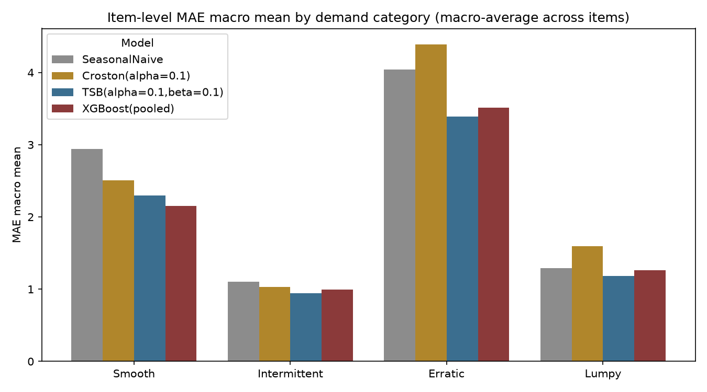
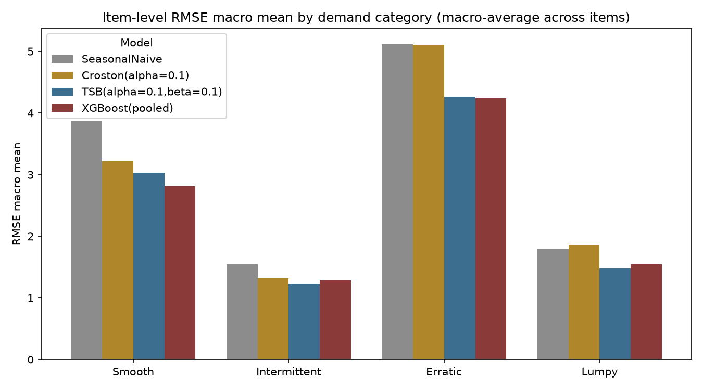
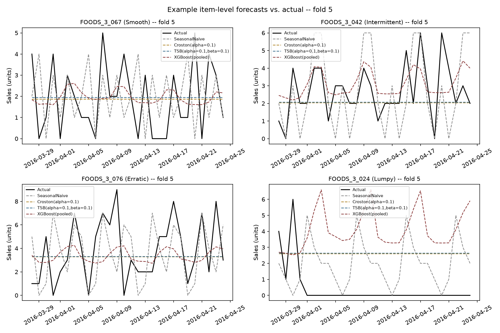
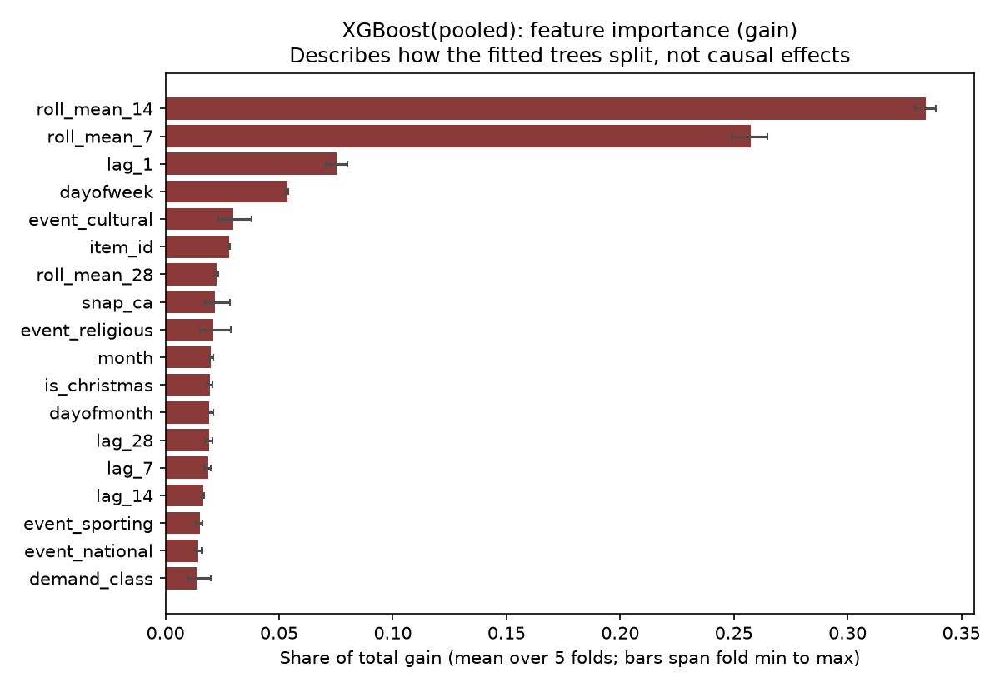

# Forecasting Intermittent Retail Demand
## Phase 3 · Step 1 — XGBoost Forecasting

*RiverDemand — A Comparative Classical–Machine Learning Framework for Inventory Decision Support using Walmart M5 Data*

|  |  |
| :--- | :--- |
| **Author** | Nitish Kumar |
| **Course** | CSET369 — Time Series Analysis |
| **Step** | Phase 3 · Step 1 — XGBoost, evaluated on the development folds only |
| **Report prepared** | 22 October 2026 |
| **Repository** | `intermittent-retail-demand-forecasting` — this file: `reports/phase3/XGBoost_Step1_Report.md` |
| **Code** | `src/models/xgboost_model.py` · `src/evaluation/item_level.py` (additive) · `notebooks/06_xgboost.ipynb` |
| **Status** | Step 1 implemented, tested and evaluated. **Phase 3 is not complete** — see §10. |

> **Scope and evidence status.** Every number in this report was read from files written by code that was actually executed on the real M5 data (store `CA_1`, department `FOODS_3`): the result files in `artifacts/forecasts/` and `artifacts/metrics/`, the figures in `reports/phase3/`, and the executed notebook `notebooks/06_xgboost.ipynb`. All evaluation uses the **development period only** (2011-01-29 → 2016-04-24, 1,913 days). The **final 28-day holdout (2016-04-25 → 2016-05-22) was not used to fit, tune, select or score any model, and no holdout performance is reported.** Completed Phase 1 and Phase 2 deliverables were preserved: of the 142 files that existed before Step 1, 136 are byte-identical, two are the placeholders created with the repository structure (`src/models/xgboost_model.py`, `notebooks/06_xgboost.ipynb`), and four received additions or a docstring edit (§2, Appendix A).

**Labels used below** (as in the Phase 2 report): **Observed** = read directly off a table or figure; **Interpretation** = a reasonable reading of an observation, not itself measured; **Plan** = future work, not a result.

**Contents**

- [1. Executive summary](#1-executive-summary)
- [2. What was implemented](#2-what-was-implemented)
- [3. Model design](#3-model-design)
- [4. Evaluation protocol and holdout separation](#4-evaluation-protocol-and-holdout-separation)
- [5. Results (development folds)](#5-results-development-folds)
- [6. Diagnostics and failure cases](#6-diagnostics-and-failure-cases)
- [7. Limitations](#7-limitations)
- [8. Verification record](#8-verification-record)
- [9. Reproduction](#9-reproduction)
- [10. What is not done — remaining Phase 3 work](#10-what-is-not-done--remaining-phase-3-work)
- [Appendix A — File-change manifest](#appendix-a--file-change-manifest)
- [Appendix B — Per-item MAE](#appendix-b--per-item-mae)
- [Appendix C — Known stale text, deliberately not edited](#appendix-c--known-stale-text-deliberately-not-edited)

## 1. Executive summary

**Headline findings** (development folds only; 20 items; errors macro-averaged over items)

1. **Model.** One *pooled* XGBoost regressor per fold, fitted on all 20 items' training windows with 18 leakage-safe features — lags 1/7/14/28, rolling means 7/14/28 that end the day before the target, calendar and M5 event/SNAP/Christmas-closure flags, item identity, and a demand class computed from the fold's training window only. Forecasts are recursive over the 28-day horizon, clipped at zero, with fixed hyper-parameters and a fixed seed; no hyper-parameter search was run. Three secondary variants (per-item, Poisson objective, no event features) were also scored (§3.7).
2. **Overall (Observed).** Mean over the 20 items of each item's five-fold mean error:

| Model | MAE | RMSE | MAPE (%) |
| :--- | ---: | ---: | ---: |
| Seasonal Naive | 2.342 | 3.083 | 83.5 |
| Croston (α = 0.1) | 2.380 | 2.876 | 64.9 |
| TSB (α = β = 0.1) | 1.954 | 2.500 | 64.3 |
| XGBoost (pooled) — primary | 1.980 | 2.467 | 66.8 |

3. **XGBoost versus TSB (Interpretation).** TSB, the strongest Phase 2 item-level baseline, and pooled XGBoost are **effectively tied**: XGBoost's MAE is 1.3% higher and its RMSE 1.3% lower, while its MAPE is 2.5 points higher. Per fold, XGBoost has the lower MAE in 2 of 5 folds and the lower RMSE in 3 of 5; the fold-to-fold gap in MAE (mean +0.026, standard deviation 0.078) is larger than its average. Neither model can be called better overall on this evidence. Against Seasonal Naive and Croston, XGBoost is clearly lower on MAE (−15.5% and −16.8%) and RMSE (−20.0% and −14.2%).
4. **By demand class (Observed).** On MAE, XGBoost is lowest in **Smooth** (2.144 vs TSB 2.298, −6.7%); TSB is lowest in Intermittent, Erratic and Lumpy (XGBoost +3.3%, +3.9% and +7.7% relative to the best baseline). On RMSE, XGBoost is lowest in Smooth (−7.3%) and Erratic (−1.0%) and TSB in the other two. Five items per class; no significance test.
5. **By item (Observed).** XGBoost has the lowest MAE among the four main models for 12 of 20 items, TSB for 7, Croston for 1, Seasonal Naive for 0. Over the 100 (item, fold) windows XGBoost beats the best of the three baselines in 51.
6. **Pooling (Observed).** The pooled model has lower macro MAE than the per-item XGBoost in 3 of 4 classes and lower MAE for 18 of 20 items, and needs 5 fits instead of 100.
7. **Where it fails (Observed).** XGBoost's largest losses are item-windows in which demand stops (zero on at least half of the 28 days in 6 of the 8 worst windows) while the recursive forecast stays near the item's recent level. Its MAE is above that of an all-zero forecast for 6 of 20 items and, on the Lumpy class, in macro average (1.277 vs 1.260) (§6).
8. **Integrity.** The holdout was provably not used (a run with every holdout sales value replaced by 1,000,000 gives identical forecasts); results are bit-identical on re-execution; the Phase 2 baselines re-run reproduce the saved Phase 2 metrics (largest difference 3.6e-15); 95 new tests were added and the full suite — 363 tests — passed (§8).

**What this report does not claim.** That XGBoost, or any model, wins overall; that these rankings will hold on the final holdout (not evaluated); that differences are statistically significant; that item-level and aggregate-series errors are comparable (different scales); or that Phase 3 is complete.

## 2. What was implemented

| Component | Where | What it does |
| :--- | :--- | :--- |
| Features and forecasters | `src/models/xgboost_model.py` (rewritten; it was a docstring-only placeholder) | `XGBoostConfig`; event-calendar loader with a read-time date filter; vectorised lag/rolling features; training-frame builder; `PooledXGBoostForecaster` (primary) and `XGBoostForecaster` (per-item, a `BaseForecaster`) |
| Pooled walk-forward runner | `src/evaluation/item_level.py` (additions only) | `run_pooled_item_level_backtest`, `check_same_evaluation_grid`, `plot_category_comparison_by_model_color`, and an `XGBoost` colour entry |
| Configuration | `config.yaml` (additions only) | `xgboost:` (features, fixed hyper-parameters), `phase3:` (output file names), `reports.phase3_dir` |
| Dependency | `requirements.txt` | `xgboost>=2.0` (developed and tested with 3.4.1) |
| Notebook | `notebooks/06_xgboost.ipynb` (replaced a placeholder) | 45 cells, executed end to end on the real data: features, protocol checks, results, diagnostics, saved outputs |
| Tests | `tests/models/test_xgboost_model.py`, `tests/evaluation/test_item_level_pooled.py`, `tests/notebooks/test_xgboost_notebook.py` | 95 new tests (§8) |
| Outputs | `artifacts/forecasts/`, `artifacts/metrics/`, `reports/phase3/` | 9 CSV files and 4 figures, all with new `xgboost_*` names (Phase 2 file names are never reused) |

**Reused unchanged from Phase 2:** `split_final_holdout`, `generate_rolling_origins`, `run_backtest`, `summarize_backtest`, `BacktestFoldResult`, `fold_results_to_long_table`, `compute_metrics` (MAE, RMSE, zero-protected MAPE), `item_development_series`, `per_item_summary`, `category_macro_average_summary`, `classify_series`, and the Phase 2 Seasonal Naive, Croston and TSB models. The Phase 2 item-level artifacts are only read.

## 3. Model design

### 3.1 Why a pooled model is the primary design

Each item has about 1,800 daily observations, which is little for a tree ensemble to learn weekly and calendar structure from alone, and half of the 20 items (the Intermittent and Lumpy classes) are sparse. One global model fitted on all items lets them share that structure through the calendar and lag features, while `item_id` and the demand class let the trees specialise. A per-item model was declared in advance as a secondary check on this decision (result in §5.5), not as a rival primary.

### 3.2 Features

Every feature of a row for target date *t* is available at the forecast origin *T < t*.

| Feature | Definition | Leakage control |
| :--- | :--- | :--- |
| `lag_1`, `lag_7`, `lag_14`, `lag_28` | sales at *t*−1, *t*−7, *t*−14, *t*−28 | Beyond *T* these are the model's **own earlier predictions** (recursion), never unseen actual sales |
| `roll_mean_7`, `roll_mean_14`, `roll_mean_28` | mean of sales over *t*−*w* … *t*−1 | The window ends at *t*−1: the series is shifted before it is averaged, so a row never contains its own target-day sales (tested by perturbation) |
| `dayofweek`, `month`, `dayofmonth` | functions of the date | known in advance |
| `snap_ca` | SNAP benefit day in California | published calendar fact |
| `event_cultural`, `event_national`, `event_religious`, `event_sporting` | 1 if `event_type_1` or `event_type_2` has that type | published calendar facts |
| `is_christmas` | 1 on the 25 December closure day | published calendar fact; `CA_1` records zero sales every 25 December |
| `item_id` | categorical identity (pooled model only) | static |
| `demand_class` | Syntetos–Boylan–Croston class (Smooth / Intermittent / Erratic / Lumpy) computed by the existing `classify_series` **from the fold's training window only** (pooled model only) | see §3.6 |

The calendar columns are read from `data/interim/panel_ca1_foods3.parquet` without ever loading `sales`, and with a read-time filter `date <= 2016-04-24`. The per-item model uses the same 16 features without `item_id` and `demand_class`.

### 3.3 Rows without lag history

A row needs 28 prior days (the largest lag or window). The first 28 rows of every item's training window are therefore **excluded from the training matrix** — 560 rows per pooled fit (28 × 20 items) — while their sales still serve as history for later rows. Nothing is imputed, back-filled or invented, and the finished matrix is asserted to contain no missing feature. At forecast time every item has at least 1,773 days of history, so every feature is available.

### 3.4 Hyper-parameters (fixed; not tuned)

| Setting | Value | Setting | Value |
| :--- | :--- | :--- | :--- |
| `objective` | `reg:squarederror` | `subsample` | 0.8 |
| `n_estimators` | 300 | `colsample_bytree` | 0.8 |
| `learning_rate` | 0.05 | `reg_lambda` | 1.0 |
| `max_depth` | 6 | `tree_method` | `hist` |
| `min_child_weight` | 1.0 | `random_state` / `n_jobs` | 42 / 1 |

These are common, moderate settings written into `config.yaml` before any result was computed. No grid or random search, no early stopping and no feature selection were run, and the feature set and hyper-parameters were not changed after any result was seen. `n_jobs = 1` keeps the histogram algorithm's floating-point summation order independent of the machine's core count; categorical features use `enable_categorical=True`. One pooled fit takes about 1.3 s on the development machine.

### 3.5 Recursive forecasting and non-negative demand

For each of the 28 forecast days, features are built from the item's history (actuals up to the origin, then earlier predictions), all items are predicted together, each prediction is **clipped at zero**, and the clipped value is appended to the history before the next day. `predict()` receives only the fitted state, so no actual from the forecast window can reach it. The clip is applied inside the recursion (a negative value is never fed back as a lag) and in the returned forecast, identically for every objective. A NaN or infinite prediction is never clipped or replaced: it raises, and the fold is recorded as failed. 72 of 2,800 raw pooled predictions (2.6%; most negative −0.187) were clipped; no fold failed.

### 3.6 Demand class: fold-local, not the Phase 1 label

The Phase 1 `demand_class` column was computed on all 1,941 days, which include every fold's forecast window and the final holdout (Phase 2 limitation L7). Used as a feature it would leak future demand behaviour, so the model uses a class recomputed from each fold's training window. The Phase 1 label is used only to *group results*, exactly as in Phase 2. For these 20 items the fold-local class equals the Phase 1 label in all five folds, so the choice does not change the grouping.

### 3.7 Variants and their status

| Variant | Status | Purpose |
| :--- | :--- | :--- |
| `XGBoost(pooled)` | **primary**, fixed before any result | the model whose results are headlined |
| `XGBoost(per-item)` | pre-declared secondary | does pooling help? Runs through the unmodified `run_backtest` |
| `XGBoost(pooled,poisson)` | pre-declared secondary | `count:poisson` objective (log link, so predictions are non-negative by construction) |
| `XGBoost(pooled,no-events)` | **post hoc**, added after the primary results were seen | exploratory: how much does the pooled result depend on the SNAP / event / closure flags? |

Secondary variants are reported for context. None was used to choose or change the primary configuration, which was not modified after results existed.

### 3.8 Deliberately not used

- **`sell_price`.** A price on a date inside the forecast horizon is only legitimate if it is a planned, known-in-advance covariate, which this dataset cannot verify, and a missing weekly price in M5 also encodes "item not on sale". The Step 1 specification did not list price; the original placeholder docstring and the Phase 2 limitation L9 mention it, so this is a **narrowing of the earlier plan**, deferred with an explicit reason (Plan: revisit with a stated availability assumption).
- **The Phase 1 `demand_class` label as an input** (§3.6) and **any data on or after 2016-04-25** (§4.3).

## 4. Evaluation protocol and holdout separation

### 4.1 Folds

The existing `generate_rolling_origins(n_obs=1913, horizon=28, n_folds=5)` gives five expanding-window folds on the development series; the notebook asserts that its dates equal those stored in the Phase 2 item-level artifacts.

| Fold | Training window (expanding) | Forecast window (28 days) | Pooled training rows |
| :---: | :--- | :--- | ---: |
| 1 | 2011-01-29 → 2015-12-06 (1,773 days) | 2015-12-07 → 2016-01-03 | 34,900 |
| 2 | 2011-01-29 → 2016-01-03 (1,801 days) | 2016-01-04 → 2016-01-31 | 35,460 |
| 3 | 2011-01-29 → 2016-01-31 (1,829 days) | 2016-02-01 → 2016-02-28 | 36,020 |
| 4 | 2011-01-29 → 2016-02-28 (1,857 days) | 2016-02-29 → 2016-03-27 | 36,580 |
| 5 | 2011-01-29 → 2016-03-27 (1,885 days) | 2016-03-28 → 2016-04-24 | 37,140 |

Pooled training rows = items × (training days − 28 warm-up days).

### 4.2 Rules applied

- **Same grid for every model.** The same 20 items (5 per demand class), the same five folds, the same 28 days, the same actuals. `check_same_evaluation_grid` confirms that the Seasonal Naive / Croston / TSB re-run and every XGBoost variant cover the same 2,800 (item, fold, date) cells with identical actuals (largest difference 0.0).
- **Fit only on pre-origin data.** The runner hands each model a training prefix of the development series; the forecast window is never passed to `fit`. A test records what `fit` receives and fails if a single later value is present.
- **Recursion updates state with predictions only** (§3.5).
- **Metrics.** MAE, RMSE and zero-protected MAPE from the existing `compute_metrics`: MAPE skips days with zero actual demand and is undefined for a window whose actuals are all zero (items with a defined MAPE per fold, pooled model: fold 1: 18, fold 2: 19, fold 3: 18, fold 4: 19, fold 5: 19).
- **Aggregation.** Metrics are computed per (item, fold), averaged over folds per item, then macro-averaged over the items of a class (or all 20). Raw errors are never pooled across items, and **item-level errors are never compared with the aggregate-series errors of Phase 2** (different scales).
- **Failures are reported, not hidden.** A failed (item, fold) is recorded with its error text and excluded from averages; here there were none (100 of 100 succeeded for every model).

### 4.3 Final holdout separation

The final holdout (2016-04-25 → 2016-05-22) is never used for training, tuning, feature or model selection, or scoring; no holdout performance is reported. Evidence, in the order in which a holdout value could enter:

1. **Data.** Series come from the existing `item_development_series`, which removes the last 28 days before any model sees them.
2. **Calendar.** `load_event_calendar` applies `date <= 2016-04-24` while reading the parquet file; a unit test spies on the read call.
3. **Perturbation on the real data.** The notebook replaces all 560 holdout sales values by 1,000,000 and repeats the whole primary run: no forecast and no actual changes.
4. **Dates.** The latest date appearing in any XGBoost result table, fold summary or loaded calendar is 2016-04-24.

## 5. Results (development folds)

All values below are **Observed** unless labelled otherwise. Lower is better. **Bold** marks the lowest value among the four main models in that row.

### 5.1 Overall

| Model | MAE | RMSE | MAPE (%) |
| :--- | ---: | ---: | ---: |
| Seasonal Naive | 2.342 | 3.083 | 83.5 |
| Croston (α = 0.1) | 2.380 | 2.876 | 64.9 |
| TSB (α = β = 0.1) | **1.954** | 2.500 | **64.3** |
| XGBoost (pooled) — primary | 1.980 | **2.467** | 66.8 |

Mean over the 20 items of each item's five-fold mean error. All 20 items have a defined MAPE. Item-level errors are on a different scale from the aggregate-series errors in the Phase 2 report and must not be compared with them.

### 5.2 By fold

Macro-average over the 20 items for each fold's 28-day window.

**MAE**

| Fold | Forecast window | Seasonal Naive | Croston (α = 0.1) | TSB (α = β = 0.1) | XGBoost (pooled) |
| :---: | :--- | ---: | ---: | ---: | ---: |
| 1 | 2015-12-07 → 2016-01-03 | 2.075 | 3.152 | **1.653** | 1.674 |
| 2 | 2016-01-04 → 2016-01-31 | 2.414 | 2.192 | 1.915 | **1.853** |
| 3 | 2016-02-01 → 2016-02-28 | 2.052 | 1.946 | 1.755 | **1.717** |
| 4 | 2016-02-29 → 2016-03-27 | 2.318 | 1.986 | **1.923** | 2.014 |
| 5 | 2016-03-28 → 2016-04-24 | 2.854 | 2.623 | **2.525** | 2.640 |
| mean | 5 folds | 2.342 | 2.380 | **1.954** | 1.980 |

**RMSE**

| Fold | Forecast window | Seasonal Naive | Croston (α = 0.1) | TSB (α = β = 0.1) | XGBoost (pooled) |
| :---: | :--- | ---: | ---: | ---: | ---: |
| 1 | 2015-12-07 → 2016-01-03 | 2.995 | 3.539 | 2.377 | **2.225** |
| 2 | 2016-01-04 → 2016-01-31 | 3.071 | 2.700 | 2.358 | **2.248** |
| 3 | 2016-02-01 → 2016-02-28 | 2.742 | 2.516 | 2.276 | **2.205** |
| 4 | 2016-02-29 → 2016-03-27 | 3.070 | 2.543 | **2.503** | 2.524 |
| 5 | 2016-03-28 → 2016-04-24 | 3.539 | 3.082 | **2.988** | 3.133 |
| mean | 5 folds | 3.083 | 2.876 | 2.500 | **2.467** |

**Observed.** XGBoost minus TSB per fold, MAE: fold 1: +0.021, fold 2: −0.062, fold 3: −0.038, fold 4: +0.091, fold 5: +0.115 (lower in 2 of 5; mean +0.026, standard deviation 0.078). RMSE: fold 1: −0.153, fold 2: −0.110, fold 3: −0.071, fold 4: +0.021, fold 5: +0.145 (lower in 3 of 5; mean −0.033, standard deviation 0.119). XGBoost is behind TSB in folds 4 and 5 on both metrics. **Interpretation:** five folds cannot say whether that is chance, a trend in the later windows, or a weakness of the model; it is flagged, not explained.

### 5.3 By demand class

Macro-average over the five items of each class.

**MAE**

| Demand class | Seasonal Naive | Croston (α = 0.1) | TSB (α = β = 0.1) | XGBoost (pooled) |
| :--- | ---: | ---: | ---: | ---: |
| Smooth | 2.940 | 2.504 | 2.298 | **2.144** |
| Intermittent | 1.103 | 1.032 | **0.946** | 0.977 |
| Erratic | 4.039 | 4.390 | **3.388** | 3.520 |
| Lumpy | 1.289 | 1.594 | **1.185** | 1.277 |

**RMSE**

| Demand class | Seasonal Naive | Croston (α = 0.1) | TSB (α = β = 0.1) | XGBoost (pooled) |
| :--- | ---: | ---: | ---: | ---: |
| Smooth | 3.872 | 3.217 | 3.035 | **2.812** |
| Intermittent | 1.549 | 1.318 | **1.223** | 1.276 |
| Erratic | 5.117 | 5.106 | 4.263 | **4.221** |
| Lumpy | 1.795 | 1.862 | **1.480** | 1.559 |

**MAPE (%)** — zero-demand days are excluded, so this is the least reliable of the three measures for sparse items.

| Demand class | Seasonal Naive | Croston (α = 0.1) | TSB (α = β = 0.1) | XGBoost (pooled) |
| :--- | ---: | ---: | ---: | ---: |
| Smooth | 87.3 | **64.8** | 67.6 | 66.5 |
| Intermittent | 77.8 | 58.0 | **51.7** | 67.7 |
| Erratic | 78.1 | 71.4 | 67.8 | **64.1** |
| Lumpy | 90.9 | **65.2** | 70.0 | 68.9 |



*Figure 1 — Macro-averaged MAE by demand class for the three Phase 2 baselines and pooled XGBoost.*



*Figure 2 — The same comparison for RMSE.*

**Observed.** Lowest MAE: Smooth — XGBoost (pooled), Intermittent — TSB (α = β = 0.1), Erratic — TSB (α = β = 0.1), Lumpy — TSB (α = β = 0.1). Lowest RMSE: Smooth — XGBoost (pooled), Intermittent — TSB (α = β = 0.1), Erratic — XGBoost (pooled), Lumpy — TSB (α = β = 0.1). Lowest MAPE: Smooth — Croston (α = 0.1), Intermittent — TSB (α = β = 0.1), Erratic — XGBoost (pooled), Lumpy — Croston (α = 0.1). XGBoost's MAE relative to the best baseline (TSB in every class): Smooth −6.7%, Intermittent +3.3%, Erratic +3.9%, Lumpy +7.7%; RMSE: Smooth −7.3%, Intermittent +4.3%, Erratic −1.0%, Lumpy +5.3%.

**Interpretation.** XGBoost's advantage sits in the Smooth class, where a stable weekly pattern gives the lag and calendar features something to learn; in the sparse classes TSB's explicit demand-probability smoothing is at least as good. That is compatible with the project's motivating hypothesis that the best method depends on the demand class, but five items per class and a different information set for the two models (§7, S1-L3) mean it is a hypothesis to test, not a finding.

### 5.4 By item

Number of items for which each model has the lowest MAE among the four main models:

| Demand class | Seasonal Naive | Croston (α = 0.1) | TSB (α = β = 0.1) | XGBoost (pooled) |
| :--- | ---: | ---: | ---: | ---: |
| Smooth | 0 | 0 | 0 | 5 |
| Intermittent | 0 | 1 | 2 | 2 |
| Erratic | 0 | 0 | 2 | 3 |
| Lumpy | 0 | 0 | 3 | 2 |
| **all 20 items** | **0** | **1** | **7** | **12** |

XGBoost has a lower MAE than TSB for 12 of 20 items, and a lower MAE than the best baseline in 51 of the 100 (item, fold) windows, yet its macro MAE is slightly *higher* than TSB's: its losses are fewer but larger. The summed per-item MAE excess where XGBoost is worse than TSB is +2.013 against −1.500 where it is better; the three largest excesses are FOODS_3_319 (Erratic, +1.028), FOODS_3_672 (Lumpy, +0.272), FOODS_3_024 (Lumpy, +0.260), and FOODS_3_319 alone accounts for 51% of the total excess. The full table is in Appendix B.

Windows (of 100) in which pooled XGBoost has a lower MAE than:

| Compared with | XGBoost lower in |
| :--- | ---: |
| Seasonal Naive | 75 of 100 |
| Croston (α = 0.1) | 69 of 100 |
| TSB (α = β = 0.1) | 60 of 100 |
| XGBoost (per-item) | 65 of 100 |
| XGBoost (pooled, Poisson objective) | 54 of 100 |
| XGBoost (pooled, no event features) | 52 of 100 |
| best of the three Phase 2 baselines, window by window | 51 of 100 |

Folds are adjacent in time and items share the calendar, so these counts are descriptive; no significance test is attempted.

### 5.5 Secondary variants and the pooling decision

| Variant | MAE | RMSE | MAPE (%) | MAE Smooth | MAE Intermittent | MAE Erratic | MAE Lumpy |
| :--- | ---: | ---: | ---: | ---: | ---: | ---: | ---: |
| XGBoost (pooled) — primary | 1.980 | 2.467 | 66.8 | 2.144 | 0.977 | 3.520 | 1.277 |
| XGBoost (per-item) | 2.058 | 2.586 | 67.6 | 2.281 | 1.111 | 3.373 | 1.468 |
| XGBoost (pooled, Poisson objective) | 1.976 | 2.461 | 64.5 | 2.165 | 0.994 | 3.446 | 1.299 |
| XGBoost (pooled, no event features) | 1.965 | 2.461 | 66.9 | 2.181 | 0.999 | 3.413 | 1.269 |

- **Pooled vs per-item (pre-declared).** Pooled is lower overall (MAE 1.980 vs 2.058; RMSE 2.467 vs 2.586), in 3 of 4 classes (the exception is Erratic: 3.520 pooled vs 3.373 per-item) and for 18 of 20 items, and needs 5 fits rather than 100 (8.7 s vs 58.6 s in the notebook run). This supports the pooling decision on this sample; it was a comparison of two designs fixed in advance, not a selection step.
- **Poisson objective (pre-declared).** Overall results are close to the primary (MAE 1.976, RMSE 2.461, MAPE 64.5 %) and it never produces a negative prediction. It was not adopted because the primary was fixed beforehand.
- **No event features (post hoc, exploratory).** Dropping the six SNAP / event / closure flags changes overall MAE from 1.980 to 1.965 and RMSE from 2.467 to 2.461. **Interpretation:** with these fixed settings the flags give no measurable overall gain on these folds; their one clear effect is on the closure day (§6.2). The variant was added after the primary results were seen and is not a basis for changing the primary model.

## 6. Diagnostics and failure cases

### 6.1 The zero-forecast yardstick (Phase 2 limitation L6)

On zero-inflated series MAE can reward low forecasts: forecasting 0 every day scores the window's mean demand. The yardstick below is **not a candidate model**; it only shows how far each model's macro MAE is from "forecast nothing".

| Demand class | Seasonal Naive | Croston (α = 0.1) | TSB (α = β = 0.1) | XGBoost (pooled) | All-zero forecast |
| :--- | ---: | ---: | ---: | ---: | ---: |
| Smooth | 2.940 | 2.504 | 2.298 | 2.144 | 4.077 |
| Intermittent | 1.103 | 1.032 | 0.946 | 0.977 | 1.043 |
| Erratic | 4.039 | 4.390 | 3.388 | 3.520 | 5.539 |
| Lumpy | 1.289 | 1.594 | 1.185 | 1.277 | 1.260 |

**Observed.** Macro MAE is *not below* the all-zero yardstick for: Intermittent: Seasonal Naive; Lumpy: Seasonal Naive, Croston (α = 0.1), XGBoost (pooled). Pooled XGBoost has a higher MAE than an all-zero forecast for 6 of 20 items:

| Item | Class | XGBoost MAE | All-zero MAE |
| :--- | :--- | ---: | ---: |
| FOODS_3_024 | Lumpy | 2.403 | 2.393 |
| FOODS_3_206 | Intermittent | 0.947 | 0.636 |
| FOODS_3_319 | Erratic | 6.135 | 5.943 |
| FOODS_3_341 | Intermittent | 0.703 | 0.614 |
| FOODS_3_672 | Lumpy | 0.812 | 0.514 |
| FOODS_3_761 | Lumpy | 0.650 | 0.593 |

**Interpretation.** In the two sparse classes an MAE ranking says little about whether a forecast is useful for stocking decisions; the inventory-oriented evaluation planned for later in Phase 3 is needed before any such claim.

### 6.2 The 25 December closure in fold 1 (Phase 2 limitation L8)

`CA_1` records zero sales on 25 December; fold 1's window contains 2015-12-25. Only the XGBoost variants with event features receive the `is_christmas` flag for that day; Seasonal Naive, Croston and TSB have no calendar information, and `XGBoost(pooled,no-events)` does not either. "Closure-day effect" is fold-1 MAE with the day minus fold-1 MAE without it (negative: the closure day made that model's fold-1 error smaller).

| Model | Mean forecast on 25 Dec (actual 0) | Fold-1 MAE, all 28 days | Fold-1 MAE, without 25 Dec | Closure-day effect |
| :--- | ---: | ---: | ---: | ---: |
| Seasonal Naive | 1.450 | 2.075 | 2.098 | −0.023 |
| Croston (α = 0.1) | 4.228 | 3.152 | 3.112 | +0.040 |
| TSB (α = β = 0.1) | 2.155 | 1.653 | 1.634 | +0.019 |
| XGBoost (pooled) — primary | 0.549 | 1.674 | 1.716 | −0.042 |
| XGBoost (per-item) | 1.834 | 1.930 | 1.934 | −0.004 |
| XGBoost (pooled, Poisson objective) | 0.105 | 1.641 | 1.698 | −0.057 |
| XGBoost (pooled, no event features) | 2.177 | 1.637 | 1.617 | +0.020 |

**Observed.** Pooled XGBoost forecasts 0.549 units on average on the closure day (Poisson variant 0.105), against 2.155 for TSB and 2.177 for the variant without event features. The day moves XGBoost's fold-1 MAE by −0.042 and TSB's by +0.019, small next to the fold-level gaps of §5.2, but it is a systematic advantage of the models that see the calendar. Fold-1 results without the day are available in the table above.

### 6.3 Largest failures and gains

Windows are ranked from all 100 (item, fold) results, not hand-picked. `Zero days` counts days with zero actual demand in the 28-day window.

**Largest shortfalls** (XGBoost MAE minus the best Phase 2 baseline's MAE)

| Item | Class | Fold | Actual mean | Forecast mean | Zero days | XGBoost MAE | Best baseline (MAE) | Difference |
| :--- | :--- | :---: | ---: | ---: | ---: | ---: | :--- | ---: |
| FOODS_3_319 | Erratic | 4 | 8.214 | 16.121 | 0 | 8.210 | Croston (α = 0.1) 4.353 | +3.857 |
| FOODS_3_319 | Erratic | 1 | 1.786 | 4.363 | 22 | 3.835 | Seasonal Naive 1.786 | +2.049 |
| FOODS_3_024 | Lumpy | 5 | 0.429 | 4.111 | 24 | 4.038 | Seasonal Naive 2.143 | +1.895 |
| FOODS_3_404 | Erratic | 5 | 1.071 | 9.662 | 24 | 8.886 | Seasonal Naive 7.429 | +1.457 |
| FOODS_3_206 | Intermittent | 2 | 0.107 | 1.649 | 27 | 1.663 | Seasonal Naive 0.964 | +0.699 |
| FOODS_3_404 | Erratic | 1 | 1.750 | 2.649 | 22 | 2.410 | Seasonal Naive 1.750 | +0.660 |
| FOODS_3_672 | Lumpy | 3 | 0.000 | 0.556 | 28 | 0.556 | Seasonal Naive 0.000 | +0.556 |
| FOODS_3_672 | Lumpy | 5 | 1.321 | 2.406 | 12 | 1.793 | Croston (α = 0.1) 1.253 | +0.540 |

**Largest gains**

| Item | Class | Fold | Actual mean | Forecast mean | Zero days | XGBoost MAE | Best baseline (MAE) | Difference |
| :--- | :--- | :---: | ---: | ---: | ---: | ---: | :--- | ---: |
| FOODS_3_348 | Smooth | 1 | 7.107 | 7.859 | 2 | 3.653 | Croston (α = 0.1) 4.449 | −0.796 |
| FOODS_3_348 | Smooth | 3 | 7.500 | 7.004 | 1 | 2.395 | Croston (α = 0.1) 3.004 | −0.610 |
| FOODS_3_313 | Erratic | 2 | 5.571 | 5.356 | 0 | 1.819 | Croston (α = 0.1) 2.394 | −0.575 |
| FOODS_3_313 | Erratic | 1 | 6.429 | 7.024 | 2 | 3.006 | Croston (α = 0.1) 3.567 | −0.561 |
| FOODS_3_404 | Erratic | 4 | 8.893 | 8.522 | 1 | 3.125 | TSB (α = β = 0.1) 3.682 | −0.558 |



*Figure 3 — Fold-5 forecasts against actuals for one item per class. XGBoost follows a weekly shape, Croston and TSB are flat, Seasonal Naive repeats the previous week. In the Lumpy panel (FOODS_3_024) demand stops after 2016-03-31 and the XGBoost forecast does not follow it.*

**Observed.** 6 of the 8 largest shortfalls have zero demand on at least half of the 28 days, and the forecast mean is far above the actual mean (FOODS_3_404 fold 5: 9.662 vs 1.071; FOODS_3_024 fold 5: 4.111 vs 0.429): demand stops while the forecast keeps the level of recent history. Seasonal Naive or Croston is the best baseline in each of these windows (Seasonal Naive in 6 of 8). A different failure is FOODS_3_319 fold 4, with no zero days at all: the forecast mean is 16.121 against an actual mean of 8.214, a level overshoot. The largest gains are in stable windows with at most two zero days (Smooth and Erratic items); the likely reason is the weekly shape captured by the calendar and lag features (Interpretation, not tested).

**Interpretation, not tested.** A model that conditions on recent history and the calendar has no signal for a sudden stop in demand (stock-out, delisting, regime change). `sell_price` would not have flagged these windows. It was checked for seven of the eight windows above (all except FOODS_3_672 fold 5) and was present on all 28 days in each, including six windows with 22–28 zero-demand days, so a price-availability flag would not have signalled these zero runs.

### 6.4 Non-negativity, failed folds and warnings

| Fold | Predictions | Clipped at 0 | Most negative raw value |
| :---: | ---: | ---: | ---: |
| 1 | 560 | 41 | −0.187 |
| 2 | 560 | 11 | −0.038 |
| 3 | 560 | 7 | −0.024 |
| 4 | 560 | 2 | −0.010 |
| 5 | 560 | 11 | −0.020 |

Of 2,800 raw pooled predictions, 72 were negative and were clipped to 0 (most negative −0.187). The Poisson variant clipped none. **No fold failed for any XGBoost variant, and no warning was captured while fitting.**

### 6.5 Feature importance



*Figure 4 — Share of total gain per feature, mean over the five pooled fits; bars span the fold minimum to maximum.*

| Feature | Mean gain share | Fold range |
| :--- | ---: | ---: |
| roll_mean_7 | 0.362 | 0.348 – 0.382 |
| roll_mean_14 | 0.222 | 0.205 – 0.244 |
| lag_1 | 0.081 | 0.074 – 0.090 |
| dayofweek | 0.055 | 0.053 – 0.056 |
| event_cultural | 0.031 | 0.029 – 0.033 |
| item_id | 0.029 | 0.027 – 0.030 |
| snap_ca | 0.024 | 0.021 – 0.027 |
| roll_mean_28 | 0.024 | 0.023 – 0.024 |
| is_christmas | 0.022 | 0.021 – 0.023 |
| month | 0.020 | 0.020 – 0.021 |
| dayofmonth | 0.020 | 0.020 – 0.021 |
| lag_28 | 0.019 | 0.018 – 0.019 |
| lag_7 | 0.018 | 0.017 – 0.018 |
| event_religious | 0.017 | 0.012 – 0.022 |
| lag_14 | 0.017 | 0.016 – 0.017 |
| event_sporting | 0.014 | 0.012 – 0.015 |
| demand_class | 0.013 | 0.010 – 0.016 |
| event_national | 0.012 | 0.011 – 0.015 |

**Observed.** The recent-level features dominate: `roll_mean_7`, `roll_mean_14` and `lag_1` together carry 0.666 of the gain, followed by `dayofweek` (0.055). The six SNAP / event / closure flags together carry 0.120; `demand_class` carries 0.013 and `item_id` 0.029. Gain importance describes how the fitted trees split, not a causal effect, and no feature was removed or changed because of it.

## 7. Limitations

| ID | Limitation | Consequence / what would address it |
| :--- | :--- | :--- |
| S1-L1 | **Five folds, 20 items, one store and department; no significance test.** Fold-to-fold variation is as large as the XGBoost–TSB gap (§5.2); Phase 2 limitation L1 applies unchanged. | More rolling origins and paired fold-level tests for the final comparison. Nothing here generalises beyond `CA_1`/`FOODS_3`. |
| S1-L2 | **Fixed, untuned hyper-parameters.** The configuration is a documented starting point, not an optimum. | Tuning, if any, belongs inside each training window (nested, time-ordered), not on the folds that are scored. |
| S1-L3 | **Different information sets.** The baselines see only each item's own history; XGBoost also sees calendar, SNAP and event flags and (pooled) other items' histories. Differences mix model class and information. | The no-event variant (post hoc) shows part of the effect; a fair final comparison should give every model the same information where possible. |
| S1-L4 | **Recursive forecasts** feed on their own predictions, which are expected values and smoother than real sales; errors can compound over 28 days. | A direct multi-horizon design was not tried. |
| S1-L5 | **Metrics.** MAE under zero inflation can flatter low forecasts (L6; §6.1); MAPE ignores zero-demand days. No inventory-relevant measure is computed. | Service-level / stock-out-versus-holding-cost evaluation in a later Phase 3 step. |
| S1-L6 | **Phase 1 demand classes** were computed on the full history (L7). They are used only to group results; the model's class feature is fold-local. | Fold-local and Phase 1 classes agree for 20 of 20 items in all 5 folds, so this sample is unaffected. |
| S1-L7 | **`sell_price` not used** (§3.8), narrowing the earlier plan. | Revisit with an explicit availability assumption. |
| S1-L8 | **Closure-day advantage.** Models with the calendar flag can anticipate 25 December; the baselines cannot (L8; §6.2). | Report fold-1 results with and without the day, as in §6.2. |
| S1-L9 | **Post hoc ablation.** `XGBoost(pooled,no-events)` was added after the primary results were seen. | Treated as exploratory; the primary configuration was not changed. |
| S1-L10 | **Floating-point reproducibility** is exact on one machine and library version (bit-identical re-runs here); another operating system, CPU or XGBoost version can differ in the last digits. The notebook test therefore asserts no metric values. `xgboost>=2.0` is a declared lower bound that was **not** tested; only 3.4.1 was. | Pin versions if exact reproduction across machines is required. |
| S1-L11 | **Result files other than the diagnostics file are byte-identical across runs;** `xgboost_fold_diagnostics.csv` contains wall-clock `fit_seconds` and so changes on every run. Running the notebook, or its test, rewrites the Step 1 result files (same values). | Expected behaviour. |
| S1-L12 | **No holdout evidence.** By design (L10); nothing here is a final-performance claim. | One-time holdout evaluation of the finally selected models at the end of Phase 3. |

## 8. Verification record

Everything in this table was run and observed in the development environment (Python 3.13.16, pandas 3.0.5, numpy 2.5.3, xgboost 3.4.1, pytest, Linux). Exact commands are in §9.

| Check | How | Observed result |
| :--- | :--- | :--- |
| Step 1 unit and integration tests | `python -m pytest tests/models/test_xgboost_model.py tests/evaluation/test_item_level_pooled.py -q` | **92 passed** (67 model tests + 25 runner tests) |
| Real-data notebook test | `python -m pytest tests/notebooks/test_xgboost_notebook.py -q` | **3 passed** — executes notebook 06 end to end on the real data (74 s in the final full run) and asserts structure and integrity strings, not metric values |
| Full suite | `python -m pytest -q` | **363 passed** in 335.5 s (5 min 35 s) (the 268 existing tests plus 95 new); no failures, no skips |
| Test sensitivity (mutation checks) | 19 distinct defects introduced one at a time into a scratch copy of the code (never the repository). In `xgboost_model.py`: rolling window including the target day; an unclipped prediction fed back as a lag; recursion state never updated; clipping removed; missing calendar dates accepted; calendar read without the date filter; `lag_7` off by one day; warm-up rows kept; `item_id` codes reversed; class labels or recursion state taken from the wrong item; `predict()` returning items in the wrong order. In `item_level.py`: `fit` given the full series; one model reused across folds; part of the holdout kept; date-alignment check removed; grid check disabled; failed folds skipped; predictions attributed to the wrong item | **19 of 19 detected** (between 1 and 26 failing tests per defect); none survived |
| Leakage tests | perturb a target-day or forecast-window value; assert features, fits and forecasts do not change; recording stub regressor sees only pre-origin rows | included in the suites above |
| Holdout perturbation, real data | all 560 holdout sales values replaced by 1,000,000; primary run repeated | no forecast and no actual changes |
| Determinism | primary run repeated with the same seed | bit-identical forecasts; the 12 deterministic result files (all but the diagnostics file) were byte-identical across independent full notebook executions |
| Phase 2 baselines reproduce | Seasonal Naive / Croston / TSB re-run inside notebook 06 | reproduce the saved Phase 2 fold metrics (largest absolute difference 3.55e-15) |
| Same evaluation grid | `check_same_evaluation_grid` | 2,800 (item, fold, date) cells, 20 items, 5 folds, identical actuals |
| Repository diff | SHA-256 of every file before Step 1 (142 files) versus after (no git repository was available) | 136 files byte-identical; 6 modified (Appendix A); 17 added, including this report; 0 removed |
| Phase 2 artifacts | hashes of the four Phase 2 item-level files before/after notebook 06 | byte-identical |

**Side effect of running the existing full suite (pre-existing behaviour, not introduced by Step 1).** The Phase 2 notebook test rewrites `artifacts/metrics/sarima_fold3_convergence_sensitivity.csv`; only its wall-clock `seconds` column changes (AIC and convergence values are identical). After each full run the delivered version was restored byte-for-byte (SHA-256 `523da0aa…`).

## 9. Reproduction

The Step 1 notebook needs the Phase 1 outputs `data/processed/selected_items_daily_sales.parquet` and `data/interim/panel_ca1_foods3.parquet`, and the Phase 2 item-level artifacts `artifacts/forecasts/item_level_backtest_long.csv` and `artifacts/metrics/item_level_backtest_fold_summary.csv` (all git-ignored; rebuilt by the earlier pipeline steps). Developed and tested with Python 3.13 and xgboost 3.4.1.

**Windows PowerShell** (the path contains spaces, so it is quoted):

```powershell
cd "D:\MY PATH\TIME SERIES PROJECT\intermittent-retail-demand-forecasting"

# 1. Dependencies (xgboost is the only new requirement)
python -m pip install -r requirements.txt

# 2. Step 1 unit and integration tests (synthetic data, well under a minute)
python -m pytest tests/models/test_xgboost_model.py tests/evaluation/test_item_level_pooled.py -q

# 3. Notebook 06 on the real data (1-2 minutes). Either open notebooks/06_xgboost.ipynb and Run All, or:
python -m pytest tests/notebooks/test_xgboost_notebook.py -q

# 4. Full suite (about 6-10 minutes depending on the machine; includes the Phase 2 notebook test)
python -m pytest -q
```

**macOS / Linux**

```bash
cd /path/to/intermittent-retail-demand-forecasting
python -m pip install -r requirements.txt
python -m pytest tests/models/test_xgboost_model.py tests/evaluation/test_item_level_pooled.py -q
python -m pytest tests/notebooks/test_xgboost_notebook.py -q
python -m pytest -q
```

Running notebook 06 (or its test) rewrites the nine Step 1 result CSV files and the four figures with the same values; only `fit_seconds` in `xgboost_fold_diagnostics.csv` changes. Running the full suite also rewrites the timing column of the Phase 2 SARIMA sensitivity file (§8).

## 10. What is not done — remaining Phase 3 work

**Phase 3 is not complete.** This report covers Step 1 only. The following are **Plan**, not results:

- LSTM/GRU and Prophet (where appropriate), each evaluated with the same folds, items and metrics;
- the final cross-model comparison, with comparable information sets and a significance-aware treatment of fold-to-fold variation;
- inventory decision support (service level, stock-out versus holding cost) and an inventory-relevant error measure;
- the Streamlit dashboard pages that read the saved artifacts;
- hyper-parameter tuning inside training windows, if wanted;
- the **one-time** evaluation of the finally selected models on the final holdout (2016-04-25 → 2016-05-22).

Nothing in this report is a final model ranking.

## Appendix A — File-change manifest

Compared with the repository state immediately before Step 1 (SHA-256 of all 142 files). **No file was removed.** Every other file is byte-identical to before, including all Phase 1 and Phase 2 source files, tests, notebooks 01–05, artifacts, figures and reports.

**Modified (6)**

| File | Change |
| :--- | :--- |
| `src/models/xgboost_model.py` | docstring-only placeholder replaced by the implementation |
| `notebooks/06_xgboost.ipynb` | placeholder replaced by the executed Step 1 notebook |
| `src/evaluation/item_level.py` | 3 original lines replaced — the `typing` import, the `backtesting` import and the plot-colour table, each only *extended* (`Any`, `generate_rolling_origins`, an `XGBoost` colour) — plus a block appended at the end of the module (the pooled runner, `check_same_evaluation_grid`, a colour-by-model bar plot); 300 lines added in total. No existing function was changed. |
| `config.yaml` | additions only: `reports.phase3_dir`, `xgboost:` and `phase3:` sections |
| `requirements.txt` | one added line: `xgboost>=2.0` |
| `src/models/__init__.py` | docstring only: records that `xgboost_model.py` is implemented |

**Added (17)**

| File | Purpose |
| :--- | :--- |
| `reports/phase3/XGBoost_Step1_Report.md` | this report |
| `reports/phase3/xgboost_category_mae_comparison.png`, `xgboost_category_rmse_comparison.png`, `xgboost_example_item_forecasts.png`, `xgboost_feature_importance.png` | figures 1–4 |
| `tests/models/test_xgboost_model.py`, `tests/evaluation/test_item_level_pooled.py`, `tests/notebooks/test_xgboost_notebook.py` | 67 + 25 + 3 = 95 tests |
| `artifacts/forecasts/xgboost_item_level_backtest_long.csv` | every forecast of every XGBoost variant (11,200 rows) |
| `artifacts/metrics/xgboost_item_level_fold_summary.csv`, `..._per_item_summary.csv`, `..._category_macro_avg_summary.csv` | per (item, fold), per item and per class metrics of the four XGBoost variants |
| `artifacts/metrics/xgboost_vs_baselines_per_item_summary.csv`, `..._category_macro_avg_summary.csv` | the same next to the three Phase 2 baselines |
| `artifacts/metrics/xgboost_fold_diagnostics.csv` | per pooled fit: rows, warm-up rows dropped, features, clipping, warnings, `fit_seconds` |
| `artifacts/metrics/xgboost_fold_local_demand_classes.csv` | the fold-local ADI / CV² / class each item received |
| `artifacts/metrics/xgboost_feature_importance.csv` | gain per feature per fold |

`artifacts/` is git-ignored like all Phase 2 artifacts.

## Appendix B — Per-item MAE

Mean MAE over each item's five folds. The lowest of the four main models is in bold.


| Item | Class | Seasonal Naive | Croston (α = 0.1) | TSB (α = β = 0.1) | XGBoost (pooled) |
| :--- | :--- | ---: | ---: | ---: | ---: |
| FOODS_3_067 | Smooth | 1.650 | 1.306 | 1.312 | **1.289** |
| FOODS_3_230 | Smooth | 3.057 | 2.264 | 2.265 | **2.084** |
| FOODS_3_263 | Smooth | 2.714 | 3.292 | 2.257 | **2.207** |
| FOODS_3_330 | Smooth | 2.400 | 2.199 | 2.191 | **2.062** |
| FOODS_3_348 | Smooth | 4.879 | 3.457 | 3.462 | **3.079** |
| FOODS_3_042 | Intermittent | 1.886 | **1.498** | 1.501 | 1.607 |
| FOODS_3_206 | Intermittent | 0.836 | 1.226 | **0.818** | 0.947 |
| FOODS_3_264 | Intermittent | 0.743 | 0.688 | 0.684 | **0.665** |
| FOODS_3_341 | Intermittent | 0.871 | 0.759 | 0.761 | **0.703** |
| FOODS_3_780 | Intermittent | 1.179 | 0.989 | **0.963** | 0.964 |
| FOODS_3_076 | Erratic | 2.250 | 1.904 | 1.903 | **1.771** |
| FOODS_3_313 | Erratic | 2.843 | 2.311 | 2.314 | **2.116** |
| FOODS_3_319 | Erratic | 5.871 | 6.226 | **5.107** | 6.135 |
| FOODS_3_404 | Erratic | 4.657 | 7.988 | **4.005** | 4.217 |
| FOODS_3_702 | Erratic | 4.571 | 3.520 | 3.609 | **3.363** |
| FOODS_3_024 | Lumpy | 2.279 | 2.989 | **2.143** | 2.403 |
| FOODS_3_271 | Lumpy | 1.500 | 1.832 | 1.400 | **1.327** |
| FOODS_3_422 | Lumpy | 1.300 | 1.245 | **1.187** | 1.193 |
| FOODS_3_672 | Lumpy | 0.586 | 1.251 | **0.540** | 0.812 |
| FOODS_3_761 | Lumpy | 0.779 | 0.653 | 0.657 | **0.650** |


## Appendix C — Known stale text, deliberately not edited

- `README.md` still carries its earlier status text.
- `src/evaluation/__init__.py` and the older lines of `src/models/__init__.py` still describe Phase 2 as in progress.
- `notebooks/04_classical_models.ipynb` still contains the marker "XGBoost — NEXT STEP — NOT YET IMPLEMENTED"; an existing test asserts that text, and notebook 04 is a completed Phase 2 deliverable.

None of these is part of Step 1.
